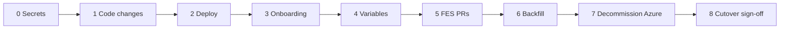

# FES Copilot Analytics Migration

Moves Copilot analytics for the FES (EUTD MMO FES) repositories from the Azure Pipelines template in
`eutd-mmo-fes-pipeline-common` (v1 payloads to Service Bus) to the shared GitHub Actions workflows in
[mmo-cr-devops-common](https://github.com/DEFRA/mmo-cr-devops-common) (v2 payloads to this dashboard,
authenticated with GitHub OIDC). Ticket: **FI0-11625**. Environment: **ext-test**.

State verified on 2026-11-06. Re-check any `VERIFY` step before acting on it.

| Tag        | Meaning                                                         |
| :--------- | :-------------------------------------------------------------- |
| `REQUIRED` | Do this step.                                                   |
| `DONE`     | Already complete. Do nothing.                                   |
| `VERIFY`   | Probably already in place. Check it; act only if it is missing. |
| `SKIP`     | Not needed for this migration. Do not perform it.               |

- [FES Copilot Analytics Migration](#fes-copilot-analytics-migration)
  - [Status at a glance](#status-at-a-glance)
  - [Scope](#scope)
  - [Shell variables](#shell-variables)
  - [Phase 0: Platform](#phase-0-platform)
    - [0.1 Entra groups for FES — `VERIFY`](#01-entra-groups-for-fes--verify)
    - [0.2 CDP Portal secrets — `REQUIRED`](#02-cdp-portal-secrets--required)
    - [0.3 Configuration — `DONE`](#03-configuration--done)
    - [0.4 Egress — `DONE`](#04-egress--done)
  - [Phase 1: Code changes](#phase-1-code-changes)
    - [1a Backfill base-branch filter — `REQUIRED`](#1a-backfill-base-branch-filter--required)
    - [1b Accept backfill tokens — `REQUIRED`](#1b-accept-backfill-tokens--required)
    - [1c FES caller workflows — `DONE`](#1c-fes-caller-workflows--done)
    - [1d Rename the CR project and make it AI-Native](#1d-rename-the-cr-project-and-make-it-ai-native)
      - [1d.1 Code — `DONE`](#1d1-code--done)
      - [1d.2 Deploy and verify — `REQUIRED`](#1d2-deploy-and-verify--required)
      - [1d.3 Remove the one-off code — `REQUIRED`](#1d3-remove-the-one-off-code--required)
  - [Phase 2: Deploy — `REQUIRED`](#phase-2-deploy--required)
  - [Phase 3: Dashboard onboarding — `REQUIRED`](#phase-3-dashboard-onboarding--required)
  - [Phase 4: Repository variables — `REQUIRED`](#phase-4-repository-variables--required)
  - [Phase 5: FES pull requests — `REQUIRED`](#phase-5-fes-pull-requests--required)
  - [Phase 6: Backfill — `REQUIRED`](#phase-6-backfill--required)
  - [Phase 7: Decommission Azure](#phase-7-decommission-azure)
  - [Phase 8: Cutover](#phase-8-cutover)
    - [8.1 Legacy data migration — `SKIP`](#81-legacy-data-migration--skip)
    - [8.2 Cutover sign-off — `REQUIRED`](#82-cutover-sign-off--required)
  - [Not part of this migration](#not-part-of-this-migration)
  - [Known risks](#known-risks)

## Status at a glance

| Step                                                      | Tag        |
| :-------------------------------------------------------- | :--------- |
| 0.1 Entra groups for FES                                  | `VERIFY`   |
| 0.2 CDP Portal secrets                                    | `REQUIRED` |
| 0.3 `cdp-app-config` (Entra, Jira, OIDC owner id)         | `DONE`     |
| 0.4 Egress allow-list                                     | `DONE`     |
| 1a Backfill `base-branch` filter (`mmo-cr-devops-common`) | `REQUIRED` |
| 1b Accept backfill tokens (this repository)               | `REQUIRED` |
| 1c FES caller workflows                                   | `DONE`     |
| 1d.1 Rename the CR project to `CRAR`, AI-Native (code)    | `DONE`     |
| 1d.2 Deploy backend 0.12.0 and verify the CR project      | `REQUIRED` |
| 1d.3 Remove the one-off code and redeploy the backend     | `REQUIRED` |
| 2 Deploy the dashboard                                    | `REQUIRED` |
| 3 Dashboard onboarding                                    | `REQUIRED` |
| 4 Repository variables                                    | `REQUIRED` |
| 5 FES pull requests                                       | `REQUIRED` |
| 6 Backfill since 2026-07-16                               | `REQUIRED` |
| 7 Decommission Azure                                      | `REQUIRED` |
| 8.1 Legacy data migration                                 | `SKIP`     |
| 8.2 Cutover sign-off                                      | `REQUIRED` |



## Scope

| Repository                              | Measured on PRs into        |
| :-------------------------------------- | :-------------------------- |
| `eutd-mmo-fes-reference-data-reader`    | `develop`                   |
| `eutd-mmo-fes-reference-shared-data`    | `develop`                   |
| `eutd-mmo-fes-internal-admin-frontend`  | `develop`                   |
| `eutd-mmo-fes-batch-data-process`       | `develop`                   |
| `eutd-mmo-fes-external-frontend`        | `develop`                   |
| `eutd-mmo-fes-function-app`             | `develop`                   |
| `eutd-mmo-fes-landings-consolidation`   | `develop`                   |
| `eutd-mmo-fes-orchestration`            | `develop`                   |
| `eutd-mmo-fes-pdf`                      | `develop`                   |
| `eutd-mmo-fes-logic-apps`               | `develop`                   |
| `eutd-mmo-fes-frontend-test-automation` | `main`                      |
| `eutd-mmo-fes-core-infra`               | `main`                      |
| `eutd-mmo-fes-pipeline-common`          | `main` (private repository) |

The measured branch is each repository's default branch. Promotion pull requests (`develop` or
`release/*` into `main`) are not measured, as with the Azure template. Jira project key: `FI0`.

## Shell variables

```bash
FES_REPOS="eutd-mmo-fes-reference-data-reader eutd-mmo-fes-reference-shared-data eutd-mmo-fes-internal-admin-frontend eutd-mmo-fes-batch-data-process eutd-mmo-fes-external-frontend eutd-mmo-fes-function-app eutd-mmo-fes-landings-consolidation eutd-mmo-fes-orchestration eutd-mmo-fes-pdf eutd-mmo-fes-logic-apps eutd-mmo-fes-frontend-test-automation eutd-mmo-fes-core-infra eutd-mmo-fes-pipeline-common"
B=feature/FI0-11625-copilot-analytics-gha
URL=https://mmo-cr-copilot-dashboard.ext-test.cdp.defra.gov.uk/api/ingest
DEVOPS="/mnt/c/Users/jkuduvar/OneDrive - Capgemini/backup/D/DEFRA-FES/github/devops"
```

## Phase 0: Platform

### 0.1 Entra groups for FES — `VERIFY`

The ext-test tenant and app registrations are already configured (0.3). Check that these groups
exist in that tenant and are assigned to the backend enterprise application; create and assign them
if not ([Entra ID setup runbook](../runbooks/entra-id-setup.md), steps 1 and 2.3):

- `AG-Users-CopilotAnalytics-FES-Admin`
- `AG-Users-CopilotAnalytics-FES-Reader`

### 0.2 CDP Portal secrets — `REQUIRED`

The dashboard release now in `main` refuses to start in ext-test without its Entra secret. Set these
in the CDP Portal → service → **Secrets** tab for **ext-test**. Values are never shown after saving,
so record each generated value in the team's password store.

| Service                    | Secret                    | Tag        | Value                                                                                             |
| :------------------------- | :------------------------ | :--------- | :------------------------------------------------------------------------------------------------ |
| `mmo-cr-copilot-dashboard` | `ENTRA_CLIENT_SECRET`     | `REQUIRED` | Dashboard app registration → **Certificates & secrets** → new client secret (12 months at most)   |
| `mmo-cr-copilot-backend`   | `JIRA_EMAIL`              | `REQUIRED` | Jira service account email; the account needs Browse permission on `FI0`                          |
| `mmo-cr-copilot-backend`   | `JIRA_API_TOKEN`          | `REQUIRED` | API token of that service account                                                                 |
| `mmo-cr-copilot-dashboard` | `SESSION_COOKIE_PASSWORD` | `VERIFY`   | Random, at least 32 characters (`openssl rand -base64 48`)                                        |
| `mmo-cr-copilot-dashboard` | `INGEST_TOKEN`            | `VERIFY`   | Already used by the running services. If either side is missing, set both to one new random value |
| `mmo-cr-copilot-backend`   | `INGEST_TOKEN`            | `VERIFY`   | The same value as the dashboard's                                                                 |
| `mmo-cr-copilot-backend`   | `SONAR_TOKEN`             | `SKIP`     | The FES SonarCloud projects are public and are read anonymously                                   |

`REDIS_*`, `MONGO_URI` and the proxy settings are platform-provided (grey) and need nothing.

### 0.3 Configuration — `DONE`

Merged in `DEFRA/cdp-app-config` #5143: Entra tenant and client ids for both services,
`JIRA_BASE_URL`, and `INGEST_OIDC_OWNER_ID=5528822` in the dashboard's `defaults.env`.

### 0.4 Egress — `DONE`

Merged in `DEFRA/cdp-tenant-config` #2125: `eaflood.atlassian.net` for the backend and
`token.actions.githubusercontent.com` for the dashboard (ext-test).

## Phase 1: Code changes

### 1a Backfill base-branch filter — `REQUIRED`

`mmo-cr-devops-common`: optional `base-branch` input on `copilot-analytics-backfill.yml`. Without it
the backfill also collects promotion pull requests and counts their commits twice. The change is
uncommitted on your local `main`.

```bash
cd ~/workspace-fes-cr/mmo-cr-devops-common
git switch -c feature/FI0-11625-backfill-base-branch
git add .github/workflows/copilot-analytics-backfill.yml README.md
git commit -m $'feat(copilot-analytics): add a base-branch filter to the backfill workflow\n\nFI0-11625\n\nCopilot-Assisted: true'
git push -u origin feature/FI0-11625-backfill-base-branch
gh pr create -R DEFRA/mmo-cr-devops-common --base main --head feature/FI0-11625-backfill-base-branch \
  --title "feat(copilot-analytics): add a base-branch filter to the backfill workflow" \
  --body "Lets callers that use develop and main skip promotion pull requests in a backfill. Needed by the FES repositories (FI0-11625)."
gh pr merge -R DEFRA/mmo-cr-devops-common feature/FI0-11625-backfill-base-branch --squash --delete-branch
```

### 1b Accept backfill tokens — `REQUIRED`

This repository: `INGEST_OIDC_WORKFLOW_REF_PREFIX` becomes a comma-separated list whose default also
accepts `copilot-analytics-backfill.yml`. Without it every backfill token is rejected with `401`.
Includes tests, the README row, the ADR 0003 note, the `.gitignore` exception for this runbook and
this runbook. The change is uncommitted on your local `main`.

```bash
cd ~/workspace-fes-cr/copilot-dashboard/mmo-cr-copilot-dashboard
git switch -c feature/FI0-11625-backfill-oidc
git add .env.example .gitignore README.md docs/adr/0003-ingest-authentication-github-oidc.md \
  docs/fes-copilot-analytics-migration/README.md src/config/config.js \
  src/server/common/helpers/github-oidc.js src/server/common/helpers/ingest-auth.test.js
git commit -m $'feat(ingest): accept OIDC tokens from the backfill workflow\n\nAdd the FES migration runbook. FI0-11625\n\nCopilot-Assisted: true'
git push -u origin feature/FI0-11625-backfill-oidc
gh pr create -R DEFRA/mmo-cr-copilot-dashboard --base main --head feature/FI0-11625-backfill-oidc \
  --title "feat(ingest): accept OIDC tokens from the backfill workflow" \
  --body "INGEST_OIDC_WORKFLOW_REF_PREFIX becomes a list; the default adds copilot-analytics-backfill.yml. Adds the FES migration runbook (FI0-11625)."
gh pr merge -R DEFRA/mmo-cr-copilot-dashboard feature/FI0-11625-backfill-oidc --squash --delete-branch
```

### 1c FES caller workflows — `DONE`

Staged on `$B` in all 13 repositories; committed in Phase 5:

- `.github/workflows/copilot-analytics.yml` — per pull request into the default branch, plus a
  manual single-PR run.
- `.github/workflows/copilot-analytics-backfill.yml` — manual backfill with `base-branch` set.
- `.analyticsignore` — the Azure template's exclusions (`public/`, `app/`, `coverage/`, `dist/`,
  `build/`).
- Azure analytics removed: in `pipeline-common` the template, root pipeline, four scripts, and the
  job and `COPILOT_ANALYTICS` variable group in four includes; the ad-hoc pipeline in `core-infra`;
  `.azurepipeline/copilot-analytics.yml` in `frontend-test-automation`.

### 1d Rename the CR project and make it AI-Native

The backend created the CR project as `FES` and AI-Adopted (`migrateDefaultProject`, since
CRAR-271). It should be `CRAR` and AI-Native, and the slug is unique, so the FES project cannot be
created until it is renamed. Admins cannot change a slug, so `mmo-cr-copilot-backend` does it once
at start-up.

#### 1d.1 Code — `DONE`

On `main` of `mmo-cr-copilot-backend`; **0.12.0** is the first version with both steps.

- **Permanent:** `migrateDefaultProject` creates the default project as `CRAR`, AI-Native, with no
  adoption date.
- **One-off:** `src/plugins/rename-default-project-slug.js`, called once from `mongodb.js`, runs two
  independent steps:
  1. **Rename**, only while project `FES` has Jira key `MMOCR` and no `CRAR` project exists. It
     moves the slug in repositories, payloads, Jira issues, sprint scope, PR–Jira links, survival
     records and persona mappings, then renames the project. It moves role mappings to `CRAR`
     except `AG-Users-CopilotAnalytics-FES-*` groups, which stay on `FES` for the real FES project,
     and adds `AG-Users-CopilotAnalytics-CRAR-Admin` (`project-admin`) and `-CRAR-Reader`
     (`project-user`). A start-up lock stops two instances running it together.
  2. **AI-Native**, for project `CRAR` with Jira key `MMOCR` that is not yet AI-Native: sets the
     type and clears the adoption date. This also fixes a project renamed by 0.10.0, which did not
     change the type.

  Existing audit entries keep `FES`; each step adds one audit event.

#### 1d.2 Deploy and verify — `REQUIRED`

- [ ] CDP Portal → `mmo-cr-copilot-backend` → deploy **0.12.0** to ext-test.
- [ ] _Manage projects_ lists **MMO Catch Recording** with slug `CRAR`, type AI-Native and no
      adoption date.
- [ ] The backend log shows `Set project CRAR to AI-Native`, and `Renamed project FES to CRAR` if
      the project was still `FES`.
- [ ] _Settings → Role Mappings_ shows `AG-Users-CopilotAnalytics-CRAR-Admin` and `-CRAR-Reader` on
      `CRAR`.

Repeat in every other environment that holds the CR project as `FES` or AI-Adopted before 1d.3.

#### 1d.3 Remove the one-off code — `REQUIRED`

Only after 1d.2 passes in every environment that needs it. The one-off then finds nothing to do on
any start, so it is dead code.

| Path                                                                        | Action                                                    |
| :-------------------------------------------------------------------------- | :-------------------------------------------------------- |
| `src/plugins/rename-default-project-slug.js`                                | Delete                                                    |
| `src/plugins/rename-default-project-slug.test.js`                           | Delete                                                    |
| `src/plugins/mongodb.js` — the `renameDefaultProjectSlug` import line       | Delete                                                    |
| `src/plugins/mongodb.js` — the `await renameDefaultProjectSlug(...)` line   | Delete                                                    |
| `src/plugins/mongodb.js` — `DEFAULT_PROJECT_SLUG` and the AI-Native default | Keep: creates a correct CR project on an empty database   |
| `src/plugins/mongodb.test.js` — the default-project test                    | Keep: covers the permanent default                        |
| `.analytics/**` records for the deleted files                               | Keep: committed attribution history, never edited by hand |
| Database: audit events and `CRAR` role mappings                             | Keep: the record of the change and the access it granted  |

```bash
cd ~/workspace-fes-cr/copilot-dashboard/mmo-cr-copilot-backend
git switch main && git pull
git switch -c chore/FI0-11625-remove-cr-project-one-off
git rm src/plugins/rename-default-project-slug.js src/plugins/rename-default-project-slug.test.js
sed -i '/renameDefaultProjectSlug/d' src/plugins/mongodb.js   # removes exactly the import and the call
grep -rn "renameDefaultProjectSlug\|rename-default-project-slug" src && echo "STOP: references remain"
npm run format:check && npm run lint && npm test
git add src/plugins/mongodb.js
git commit -m $'chore(projects): remove the one-off CR project migration\n\nThe FES to CRAR rename and AI-Native conversion have run. FI0-11625\n\nCopilot-Assisted: true'
git push -u origin chore/FI0-11625-remove-cr-project-one-off
gh pr create -R DEFRA/mmo-cr-copilot-backend --base main --head chore/FI0-11625-remove-cr-project-one-off \
  --title "chore(projects): remove the one-off CR project migration" \
  --body "The FES to CRAR rename and AI-Native conversion have run (FI0-11625). Keeps the CRAR, AI-Native default for empty databases."
gh pr merge -R DEFRA/mmo-cr-copilot-backend chore/FI0-11625-remove-cr-project-one-off --squash --delete-branch
```

Then deploy the resulting backend version to ext-test and check that _Manage projects_ still shows
`CRAR` as AI-Native.

## Phase 2: Deploy — `REQUIRED`

The dashboard running in ext-test is an old build (no Entra sign-in, shared-token ingest only), so
OIDC ingest cannot work until it is replaced.

- [ ] CDP Portal → `mmo-cr-copilot-dashboard` → deploy **0.13.0 or later** to ext-test (0.13.0 is
      the 1b merge). The backend is already deployed in 1d.
- [ ] Check: `https://mmo-cr-copilot-dashboard.ext-test.cdp.defra.gov.uk/` sends you to Microsoft
      sign-in, and you can sign in as a member of the bootstrap admin group
      (`AG-Users-CopilotAnalytics-Dashboard-Admin`).

## Phase 3: Dashboard onboarding — `REQUIRED`

In the dashboard UI as a `Dashboard.Admin` ([Onboard a project](../../README.md#onboard-a-project)).
There is no CLI. Unmapped repositories are refused with `403`, so finish this before Phase 5.

- [ ] `REQUIRED` **Create the project** (_Manage projects_): name `FES`, slug `FES`, type
      AI-Adopted, adoption date, Jira project key `FI0`.
- [ ] `REQUIRED` **Map the repositories** (_Repository mapping_): all 13 as `DEFRA/<name>` → `FES`.
- [ ] `REQUIRED` **SonarCloud keys**: `DEFRA_<name>` for the nine repositories with a SonarCloud
      project. `SKIP` for `logic-apps`, `frontend-test-automation`, `core-infra` and
      `pipeline-common`; they have none.
- [ ] `VERIFY` **Role mappings** (_Settings → Role Mappings_):
      `AG-Users-CopilotAnalytics-FES-Admin` → `project-admin` on `FES`;
      `AG-Users-CopilotAnalytics-FES-Reader` → `project-user` on `FES`. Mappings for these groups
      that were already on `FES` stay there after 1d; add only the ones missing.
- [ ] `SKIP` **Persona mappings**: optional enrichment, not needed for the migration.

## Phase 4: Repository variables — `REQUIRED`

None of the FES repositories has the variable yet. No repository secret is needed.

```bash
for r in $FES_REPOS; do gh variable set COPILOT_ANALYTICS_INGEST_URL -R DEFRA/$r --body "$URL"; done
for r in $FES_REPOS; do echo "$r: $(gh variable get COPILOT_ANALYTICS_INGEST_URL -R DEFRA/$r)"; done
```

`SKIP` the organisation-level variable: it needs org admin and gains nothing for 13 repositories.

## Phase 5: FES pull requests — `REQUIRED`

Each pull request runs the new workflow from its own branch, so it is also the smoke test.

```bash
gh auth setup-git   # WSL git has no credentials for the private pipeline-common
MSG=$'ci(copilot-analytics): move Copilot analytics to GitHub Actions\n\nReplace the Azure Pipelines analytics job with the shared mmo-cr-devops-common\nreusable workflows (OIDC ingest to the Copilot analytics dashboard). FI0-11625\n\nCopilot-Assisted: true'
for r in $FES_REPOS; do
  case $r in eutd-mmo-fes-core-infra|eutd-mmo-fes-pipeline-common) d="$DEVOPS/$r";; *) d=~/workspace/$r;; esac
  base=$(gh api repos/DEFRA/$r --jq .default_branch)
  git -C "$d" commit -m "$MSG" && git -C "$d" push -u origin $B && \
  gh pr create -R DEFRA/$r --base "$base" --head $B \
    --title "FI0-11625 Move Copilot analytics to GitHub Actions" \
    --body "Adds the Copilot Analytics and Backfill caller workflows (DEFRA/mmo-cr-devops-common) and .analyticsignore; removes the Azure Pipelines analytics job."
done
```

Never use `git commit -a` in `pipeline-common` or `core-infra`: their Windows working copies show
line-ending changes on about 100 unrelated files.

Check every run before merging:

```bash
for r in $FES_REPOS; do echo "== $r"; gh run list -R DEFRA/$r --workflow copilot-analytics.yml --limit 1; done
```

| Job summary shows | Cause                                                                           |
| :---------------- | :------------------------------------------------------------------------------ |
| Published         | Done                                                                            |
| HTTP 401          | Old dashboard build still deployed, or `INGEST_OIDC_OWNER_ID` missing (Phase 2) |
| HTTP 403          | Repository not mapped to `FES` (Phase 3)                                        |
| No ingest URL     | `COPILOT_ANALYTICS_INGEST_URL` missing (Phase 4)                                |

Merge the 12 other pull requests first and `pipeline-common` last; that merge is what removes the
Azure analytics job from every FES build.

```bash
gh pr merge -R DEFRA/<repo> $B --squash --delete-branch
```

## Phase 6: Backfill — `REQUIRED`

Needs 1a and 1b. Republishes every FES pull request merged since the first FES analytics producer
(2026-07-16, on the spike branch), so the dashboard holds the full FES history recomputed from git.
Re-runs are safe: the backend keeps a live merged record and only replaces a backfill with a newer
one.

```bash
SINCE=2026-07-16
for r in $FES_REPOS; do
  ref=$(gh api repos/DEFRA/$r --jq .default_branch)
  gh workflow run copilot-analytics-backfill.yml -R DEFRA/$r --ref "$ref" -f since=$SINCE -f max-prs=500
done
for r in $FES_REPOS; do gh run list -R DEFRA/$r --workflow copilot-analytics-backfill.yml --limit 1; done
```

Each run's job summary lists every pull request with `published`, `skipped` or `failed`.

| Backfill shows                                                     | Cause and fix                                                                                                                                                                                      |
| :----------------------------------------------------------------- | :------------------------------------------------------------------------------------------------------------------------------------------------------------------------------------------------- |
| `HTTP 401` on every pull request while per-PR runs publish (`201`) | The dashboard rejects the backfill workflow ref: a version before 0.13.0 is deployed, or `INGEST_OIDC_WORKFLOW_REF_PREFIX` is overridden without `copilot-analytics-backfill.yml@`. Deploy 0.13.0+ |
| `HTTP 403`                                                         | Repository not mapped to `FES` (Phase 3)                                                                                                                                                           |
| `skipped (no countable commits)`                                   | Expected for merge-only or Dependabot pull requests                                                                                                                                                |

After a fix, re-run the backfill; pull requests already published are kept. Re-run a single pull
request with:

```bash
gh workflow run copilot-analytics.yml -R DEFRA/<repo> --ref <default-branch> -f pr_number=<n>
```

## Phase 7: Decommission Azure

After the `pipeline-common` pull request is merged.

- [ ] `REQUIRED` Delete the Azure DevOps analytics pipeline definitions for `core-infra`,
      `pipeline-common` and `frontend-test-automation`; their YAML files no longer exist.
- [ ] `REQUIRED` Delete the `COPILOT_ANALYTICS` variable group; it holds the Service Bus connection
      string and nothing references it now.
- [ ] `SKIP` Deleting the Service Bus queue and the old dashboard database. They belong to the old
      dashboard and are retired by its owner (8.2); this migration no longer needs them.

```bash
ORG=https://dev.azure.com/<organisation>; PROJECT=<project>
az pipelines list --org $ORG -p $PROJECT --query "[?contains(name,'copilot')].{id:id,name:name}" -o table
az pipelines delete --id <id> --org $ORG -p $PROJECT --yes
az pipelines variable-group list --group-name COPILOT_ANALYTICS --org $ORG -p $PROJECT --query "[].id"
az pipelines variable-group delete --group-id <id> --org $ORG -p $PROJECT --yes
```

## Phase 8: Cutover

### 8.1 Legacy data migration — `SKIP`

Decided 2026-11-06: not needed. The Phase 6 backfill republished every FES pull request since
2026-07-16, when the Azure producer first ran, so the old dashboard's database
(`copilot_analytics.payloads`) holds nothing the dashboard is missing. Its records classify commits
only by the `Copilot-Assisted` trailer, which the backfill reads from the same commits. Skipping it
also avoids switching on break-glass shared-token ingest and copying personal data to a
workstation.

If a FES pull request is ever found missing, re-run it with a single-PR run (Phase 6). The legacy
tooling stays in `mmo-cr-devops-common/.github/scripts/copilot-analytics/legacy-migration` with its
own README.

### 8.2 Cutover sign-off — `REQUIRED`

- [ ] A new FES pull request publishes (Phase 5 smoke test, then normal use).
- [ ] The backfill summaries show no `failed` pull requests (Phase 6).
- [ ] Azure analytics pipelines and the `COPILOT_ANALYTICS` variable group are gone (Phase 7).
- [ ] The old dashboard's owner is told FES no longer feeds the Service Bus queue and its data is
      not needed for the migration, so the queue and database can be retired.

## Not part of this migration

| Item                                                 | Tag    | Why                                                                                                    |
| :--------------------------------------------------- | :----- | :----------------------------------------------------------------------------------------------------- |
| Survival workflow (`copilot-analytics-survival.yml`) | `SKIP` | Out of scope; can be added later with `COPILOT_ANALYTICS_SURVIVAL_URL`                                 |
| Production environment                               | `SKIP` | Later; repeat Phases 0, 2 and 4 for `prod` when the production dashboard exists                        |
| AI Attribution VS Code extension for FES developers  | `SKIP` | Recommended for better attribution, but not needed to migrate; the trailer still works                 |
| `id-token: write` in the CR caller workflows         | `SKIP` | A CR task. Eight CR callers still pass the retired shared token and will not publish until they add it |

## Known risks

- `.analyticsignore` keeps `app/` excluded, as the Azure template did. In
  `eutd-mmo-fes-external-frontend` that folder holds about 400 source files, so its line counts stay
  low. Remove the `app/` line there to count them.
- `includes/playwright-tests.yaml` no longer has the `Initialize` stage; a run with every `runOn*`
  flag `false` has no stages and is rejected by Azure DevOps.
- `pipeline-common` is private, so its workflow runs use the DEFRA organisation's Actions minutes.
- The dashboard client secret expires after at most 12 months; sign-in fails when it does.
